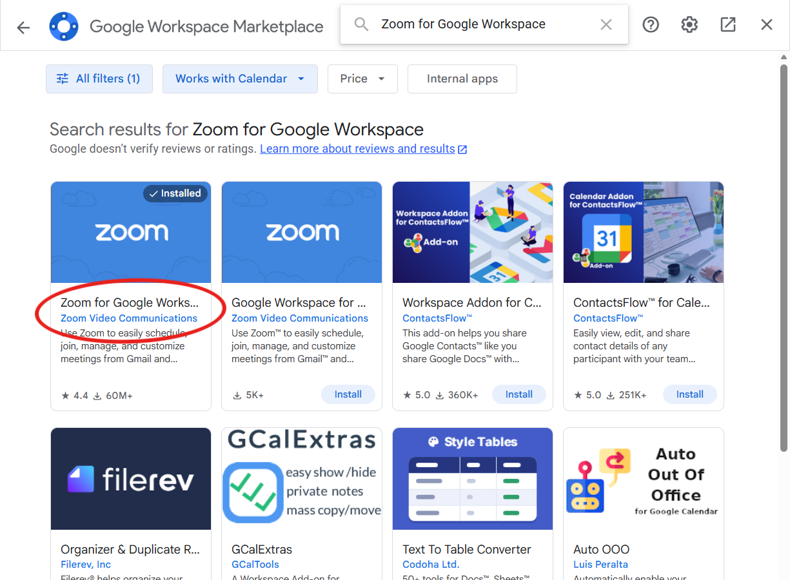
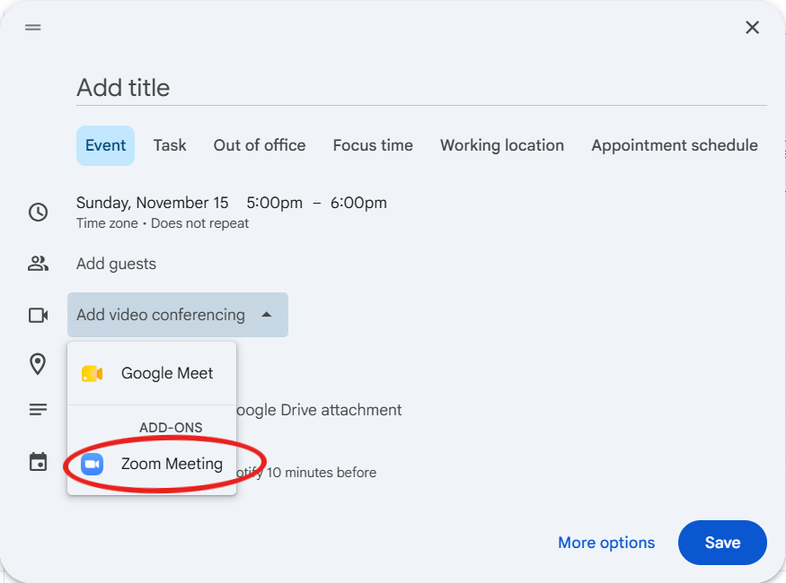

# How to Schedule a Zoom Meeting from Your ISC Google Calendar

InnerSource Commons runs its meetings on Zoom.
You schedule one from your `@innersourcecommons.org` Google Calendar with the Zoom add-on, and the invite carries the Zoom link.
You do not need to sign in to the Zoom website to host a meeting this way.

Scheduling from your ISC account puts the event on your ISC calendar and creates the Zoom meeting under the Foundation's shared Zoom account.
For the shared Zoom login itself, see [How We Run Shared Logins](shared-logins).

## Install the Zoom add-on (once)

1. Open [Google Calendar](https://calendar.google.com) signed in to your `@innersourcecommons.org` account.
2. Look for the blue Zoom icon in the right-hand side rail.
   If it is there, the add-on is installed and you can skip to the next section.
3. Otherwise, click the **+** (Get add-ons) at the bottom of the side rail.
   The Google Workspace Marketplace opens.
4. Search for **Zoom for Google Workspace**, click **Install**, and approve the permissions.

## Schedule a meeting with a Zoom link

1. In Google Calendar, click **Create**, then **Event**.
2. Add a title, the date and time, and your guests.
3. Click **Add video conferencing** and choose **Zoom Meeting**, listed under **ADD-ONS**.
4. If a Google Meet link was added to the event on its own, remove it so guests see one link.
5. Click **Save**, and choose to send the invitation to your guests.

The invitation includes the Zoom link, the meeting ID, and the passcode.

## Getting help

Ask in the [#google-admins](https://innersourcecommons.slack.com/archives/C06V6RGLBP1) Slack channel.
